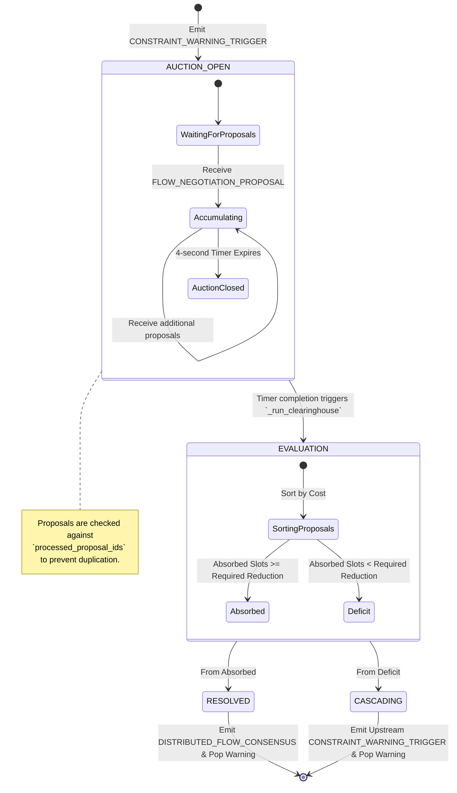
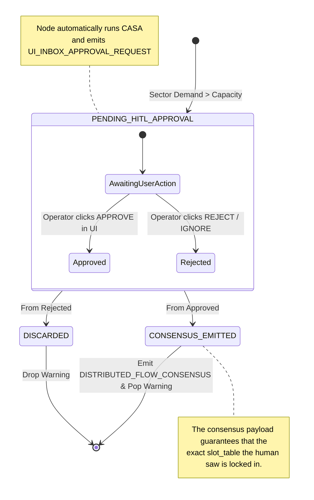

# DDFN v2 Node State-Machines

In a decentralized environment, nodes must govern their localized state machines vigorously to avoid hanging threads or dropped network negotiations. The two primary state-machine actors in DDFN v2 are **Airport Nodes** (managing edge auctions) and **FMP Nodes** (managing Human-In-The-Loop sector capacity).

Below are the Mermaid state diagrams illustrating the lifecycles of Capacity Constraint Warnings (`self.pending_warnings`) internally within each node.

*(Note: "nano banana" usually refers to standard Mermaid diagramming in this context!)*

---

## 1. Airport Node: Clearinghouse State Machine (`airport_service.py`)

When an airport's Arrival Acceptance Rate (AAR) is breached, it acts as the primary Clearinghouse for a Ground Delay Program (GDP).

### Key Behaviors:
- **`AUCTION_OPEN`**: The airport locks the warning ID and opens a 4-second non-blocking window (`asyncio.sleep(4.0)`) to collect downstream `FLOW_NEGOTIATION_PROPOSAL`s.
- **Fail-Forward (`CASCADING`)**: If the node cannot absorb the entire delay constraint using available ground-delay capacity, it explicitly cascades a new warning to the adjacent en-route sector.

---

## 2. FMP Node: HITL State Machine (`fmp_service.py`)

The FMP node enforces Human-In-The-Loop approval for sector capacity restrictions, relying heavily on the UI Dashboard for resolution.

### Key Behaviors:
- **Proactive Ripple `CTOT_ASSIGNMENT_PROPOSAL`**: While in `PENDING_HITL_APPROVAL`, the FMP proactively emits a proposal backwards into the SWIM mesh.
- **No Background Timer**: Unlike the Airport node, the FMP does not auto-resolve. A warning stays persistently in `self.pending_warnings` until explicitly actioned by an ATFM operator via the REST API endpoints governed by the React UI. 
- **Idempotency Locking**: If multiple users are logged into the same FMP dashboard, clicking "Approve" triggers `processed_consensus_ids` locking before emitting the broadcast to avoid accidentally finalizing a double-delay.
